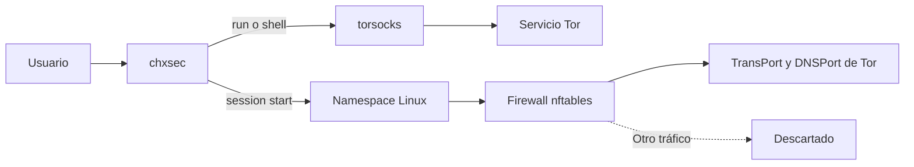

  <h1>ChxChx Security</h1>
  
<strong>Privacidad de red por proceso para Linux.</strong> Usa Tor donde tú lo decides, con comandos claros y sesiones aisladas cuando las necesitas.

  

    
    
    
    
    
  

  

    <a href="#instalación">Instalar</a> ·
    <a href="#primeros-pasos">Primeros pasos</a> ·
    <a href="#comandos">Comandos</a> ·
    <a href="#seguridad-y-límites">Seguridad</a>
  

> [!WARNING]
> **Versión Alpha 0.2.0.** Los instaladores rápidos descargan la rama mutable <code>dev</code>. La integración privilegiada en una VM desechable y las instalaciones limpias por distribución siguen pendientes.

## ¿Qué es ChxChx Security?

Una herramienta de terminal para Fedora, Ubuntu y Kali Linux. Coordina Tor, <code>torsocks</code>, NetworkManager, namespaces y <code>nftables</code> para que puedas elegir qué aplicación ejecutas por una ruta protegida.

**No crea un túnel global:** iniciar Tor no cambia la conexión de todo el equipo. Se protegen los programas que lanzas expresamente mediante <code>chxsec run</code>, <code>chxsec shell</code> o una sesión aislada.

## Cómo funciona

## Instalación

Los instaladores preparan un entorno Python en <code>~/.local/share/chxchx-security</code> y pueden instalar Python, Tor, <code>torsocks</code>, NetworkManager, <code>iproute</code>/<code>iproute2</code> y <code>nftables</code>. No requieren Docker. Descarga el script primero y ejecútalo desde la terminal; evita <code>curl | bash</code>.

| Distribución | Requisitos | Instalador |
| --- | --- | --- |
| Fedora | DNF · Python 3.11+ | [Descargar instalador](https://github.com/chxchx-dev/chxchx-security-ip/raw/refs/heads/dev/install-remote-fedora.sh?download=1) |
| Ubuntu 24.04 o posterior | APT · Python 3.11+ | [Descargar instalador](https://github.com/chxchx-dev/chxchx-security-ip/raw/refs/heads/dev/install-remote-debian.sh?download=1) |
| Kali Linux actual | APT · Python 3.11+ | [Descargar instalador](https://github.com/chxchx-dev/chxchx-security-ip/raw/refs/heads/dev/install-remote-debian.sh?download=1) |

[Descargar el código fuente (.tar.gz)](https://github.com/chxchx-dev/chxchx-security-ip/archive/refs/heads/dev.tar.gz)

### Fedora

~~~bash
curl --fail --location --show-error --retry 3 --connect-timeout 20 --max-time 120 \
  --output install-chxsec-fedora.sh \
  https://raw.githubusercontent.com/chxchx-dev/chxchx-security-ip/dev/install-remote-fedora.sh
bash install-chxsec-fedora.sh
~~~

### Ubuntu y Kali Linux

~~~bash
curl --fail --location --show-error --retry 3 --connect-timeout 20 --max-time 120 \
  --output install-chxsec-debian.sh \
  https://raw.githubusercontent.com/chxchx-dev/chxchx-security-ip/dev/install-remote-debian.sh
bash install-chxsec-debian.sh
~~~

El instalador pregunta antes de añadir paquetes del sistema. Para aceptar esa instalación sin la pregunta, ejecuta el script con <code>--yes</code>.

### Al terminar

~~~bash
source ~/.local/share/chxchx-security/.venv/bin/activate
chxsec doctor
chxsec
~~~

<code>doctor</code> revisa el sistema y <code>chxsec</code> abre el menú guiado. **Tor no se inicia durante la instalación.**

## Primeros pasos

### Menú interactivo

Ejecuta <code>chxsec</code> desde una terminal. El menú te permite volver después de cada acción:

| Opción | Acción |
| --- | --- |
| 1 | Revisar dependencias y estado del sistema |
| 2–5 | Iniciar, detener, consultar y verificar Tor |
| 6 | Abrir una shell protegida |
| 7 | Ver perfiles de NetworkManager |
| 8 | Ejecutar un comando protegido |
| 9 | Abrir la guía de comandos |
| 0 | Salir |

Sin una terminal interactiva, <code>chxsec</code> muestra la ayuda de la CLI.

### Ejecutar una aplicación mediante Tor

~~~bash
chxsec tor start
chxsec tor verify
chxsec run -- curl https://example.com
chxsec tor stop
~~~

<code>run</code> protege solo el comando indicado. La verificación oculta la IP de salida de forma predeterminada; usa <code>chxsec tor verify --reveal-ip</code> para mostrarla expresamente.

> [!NOTE]
> Tor permanece activo al salir del menú porque es un servicio compartido del sistema. <code>chxsec tor stop</code> también desconecta las otras aplicaciones que estén usando Tor.

### Cambiar la política MAC

~~~bash
chxsec mac list
chxsec mac apply "Mi WiFi" random
~~~

Aplicar una política cambia el perfil seleccionado en NetworkManager. Añade <code>--reconnect</code> solo si puedes permitir que se interrumpa la conexión.

## Comandos

| Quiero… | Comando |
| --- | --- |
| Comprobar preparación del sistema | <code>chxsec doctor</code> |
| Obtener el diagnóstico en JSON | <code>chxsec doctor --json</code> |
| Consultar el servicio Tor | <code>chxsec tor status</code> |
| Iniciar o detener Tor | <code>chxsec tor start</code> · <code>chxsec tor stop</code> |
| Comprobar la ruta Tor | <code>chxsec tor verify</code> |
| Ejecutar una aplicación compatible | <code>chxsec run -- &lt;comando&gt;</code> |
| Abrir una shell temporal protegida | <code>chxsec shell</code> |
| Consultar perfiles de red | <code>chxsec mac list</code> |
| Revisar herramientas para sesiones | <code>chxsec session tools</code> |

<code>run</code> y <code>shell</code> dependen de una aplicación compatible con Tor por TCP. Para aislamiento adicional, usa una sesión de red.

## Sesiones de red aisladas

Una sesión crea un namespace con firewall de denegación por defecto y listeners Tor privados. Su tráfico TCP y DNS se redirige a Tor; el resto, incluido IPv6, se descarta.

> [!CAUTION]
> Estas opciones modifican recursos de red del sistema. Primero revisa el plan. Prueba los cambios privilegiados en una VM desechable con snapshot.

~~~bash
# Revisar herramientas y plan; no aplica cambios.
chxsec session tools
chxsec session plan demo

# Simular la sesión completa.
chxsec session start demo -- curl https://example.com

# Aplicar los cambios privilegiados y ejecutar el comando.
chxsec session start --yes demo -- curl https://example.com
~~~

La sesión completa elimina sus recursos cuando el comando termina, también al interrumpirlo con Ctrl-C. Si aplicas las etapas manualmente, guarda el identificador y ejecuta <code>chxsec session destroy &lt;id&gt;</code> al terminar. Aún no hay un comando para listar sesiones; [RECOVERY.md](RECOVERY.md) explica cómo recuperarse si la limpieza falla.

## Seguridad y límites

| ChxChx Security hace | No hace |
| --- | --- |
| Ejecuta mediante Tor procesos compatibles que eliges explícitamente. | No enruta automáticamente todo el equipo. |
| Falla si no encuentra el listener SOCKS; no usa una conexión directa como alternativa. | No garantiza anonimato ni elimina rastros del sistema. |
| En sesiones aisladas, bloquea protocolos fuera de las reglas de Tor. | <code>run</code> no protege UDP ni aplicaciones que evadan <code>torsocks</code>. |
| Oculta identificadores locales e IP pública en las salidas predeterminadas. | No oculta huellas del navegador, cuentas, cookies, WebRTC o telemetría. |

Para navegación anónima, usa Tor Browser. Un navegador normal no se vuelve anónimo solo por ejecutarse mediante un proxy.

El programa no guarda registros de ejecución por defecto ni recopila el nombre de usuario o el hostname. <code>doctor</code> y <code>mac list</code> ocultan identificadores locales; <code>tor verify</code> oculta la IP salvo que pidas mostrarla.

## Actualizar o desinstalar

### Actualizar

Descarga otra vez el instalador de tu distribución y ejecútalo. Por defecto sigue <code>dev</code> y reemplaza los archivos instalados; no ofrece rollback automático. Conserva una copia si necesitas volver a la versión anterior.

### Desinstalar

Destruye primero cualquier sesión manual pendiente. Luego elimina el directorio de la herramienta:

~~~bash
chxsec session destroy <id>
rm -rf -- "$HOME/.local/share/chxchx-security"
~~~

El segundo comando elimina solo los archivos de ChxChx Security; no desinstala Tor, NetworkManager ni otros paquetes del sistema. Si cambiaste <code>XDG_DATA_HOME</code> o <code>CHXSEC_INSTALL_DIR</code>, sustituye la ruta por la ubicación exacta.

<strong>Instalar desde una copia local, fijar una versión o desarrollar</strong>

### Instalar desde un checkout

~~~bash
# Fedora
./install-fedora.sh --yes

# Ubuntu o Kali
./install-debian.sh --yes

source .venv/bin/activate
chxsec doctor
~~~

Usa <code>--dry-run</code> para revisar las acciones del instalador local. <code>--no-system-packages</code> omite la instalación de paquetes del sistema cuando ya están presentes.

### Fijar una referencia del código fuente

Los bootstraps aceptan una etiqueta de release o un SHA completo de 40 caracteres. Para fijar una referencia, configura también el SHA-256 del archivo descargado:

~~~bash
export CHXSEC_SOURCE_REF="<etiqueta vX.Y.Z o commit de 40 caracteres>"
export CHXSEC_SOURCE_ARCHIVE_SHA256="<SHA-256 del archivo fuente>"
bash install-chxsec-fedora.sh
~~~

Reemplaza ambos valores de ejemplo. El bootstrap comprueba el SHA-256 antes de extraer el código.

### Ejecutar pruebas y build

~~~bash
./install-fedora.sh --yes --with-dev
source .venv/bin/activate
pytest
python -m build --sdist --wheel
~~~

La matriz CI cubre Fedora, Ubuntu 24.04 y Kali rolling, además de Python 3.11 y 3.13. La integración privilegiada de namespaces, firewall y Tor sigue pendiente de ejecutarse en una VM Fedora desechable.

## Licencia

Distribuido bajo la [Licencia MIT](LICENSE).
